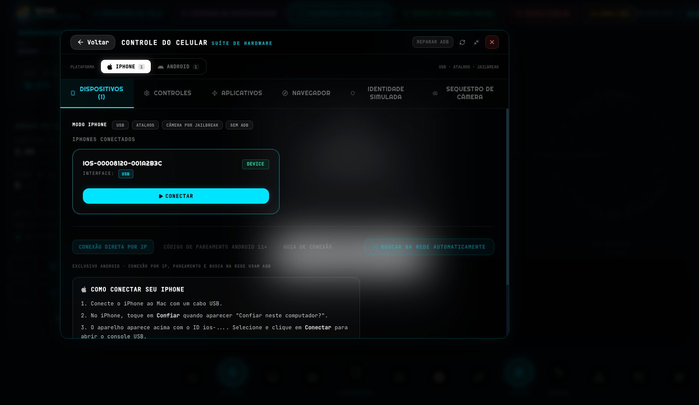
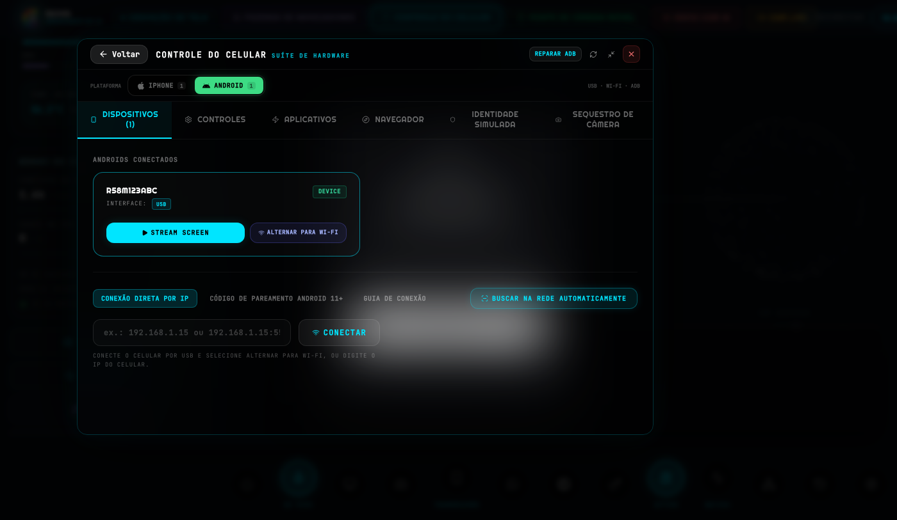
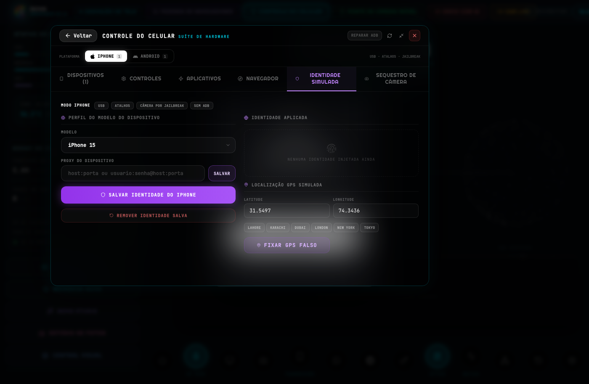

# Controle do Celular — telas separadas de iPhone e Android

Duas telas dentro do mesmo modal: um seletor **iPhone | Android** logo abaixo do cabeçalho.
Cada lado mostra só os aparelhos e as funções daquela plataforma.







## O que muda

- **Seletor de plataforma** com contagem de aparelhos de cada lado. A escolha do usuário fica fixa;
  enquanto ele não escolhe, a tela segue o primeiro aparelho conectado.
- **Dispositivos filtrados**: o lado iPhone lista só `ios-…`; o lado Android lista só ADB/ Wi-Fi.
  A contagem em "Dispositivos (n)" e a seleção do cartão acompanham o filtro.
- **iPhone**:
  - Conectar abre o console USB (ios-bridge), como antes.
  - Conexão por IP, pareamento Android 11+ e busca na rede ficam desabilitados, com o aviso
    "Exclusivo Android · conexão por IP, pareamento e busca na rede usam ADB".
  - Guia próprio de conexão (USB, Confiar, Atalhos para Wi-Fi/Bluetooth, jailbreak para a câmera).
  - "Identidade simulada" abre normalmente. No iPhone o painel mostra só **Modelo**
    (iPhone 7 a 18, com as variantes), um campo de **Proxy** (host:porta ou
    usuario:senha@host:porta) e o botão **Salvar identidade do iPhone**, que guarda
    modelo + proxy no perfil local do aparelho. Marca, IMEI, Play Integrity, certificação da Play Store e
    comandos Android ficam ocultos nesse lado. A troca de modelo no aparelho ainda
    depende de um hook no jailbreak; o proxy ainda não é aplicado no Wi-Fi.
  - "Reparar ADB" vira um selo desabilitado; reiniciar/desligar celular ficam desabilitados
    com o selo "Exclusivo Android".
  - Faixa "Modo iPhone" com os chips USB · Atalhos · Câmera por jailbreak · Sem ADB.
- **Android**: tudo como antes (USB, Wi-Fi, pareamento, busca na rede, identidade, câmera).

## Arquivos

| Arquivo | Papel |
|---|---|
| `aplicar.py` | aplica o patch no bundle do renderer e valida a sintaxe com `node --check` |
| `index-Dun7lr2S.patched.js` | cópia do bundle já corrigido |
| `git show 1b45c3f:MAC/controle-celular-plataformas/reservas/index-Dun7lr2S.antes-20261104.js` | bundle original, antes desta alteração (a pasta `reservas/` foi apagada) |
| `docs/*.png` | capturas das duas telas (teste em navegador com dispositivos simulados) |

Bundle instalado: `/Applications/Nova AI Mac.app/Contents/Resources/app/dist/assets/index-Dun7lr2S.js`.

## Reaplicar / desfazer

Reaplicar (depois de uma atualização do app, se o nome do bundle continuar o mesmo):

```sh
cd "/Users/aquilesneri/Desktop/Nova-AI/MAC/controle-celular-plataformas"
git show 1b45c3f:MAC/controle-celular-plataformas/reservas/index-Dun7lr2S.antes-20261104.js > /tmp/original.js
python3 aplicar.py /tmp/original.js /tmp/novo.js
cp /tmp/novo.js "/Applications/Nova AI Mac.app/Contents/Resources/app/dist/assets/index-Dun7lr2S.js"
```

Desfazer (volta ao visual anterior):

```sh
git show 1b45c3f:MAC/controle-celular-plataformas/reservas/index-Dun7lr2S.antes-20261104.js > /tmp/original.js
cp /tmp/original.js \
   "/Applications/Nova AI Mac.app/Contents/Resources/app/dist/assets/index-Dun7lr2S.js"
```

Feche e reabra o Nova depois de qualquer troca de bundle.

## Como foi testado

- Sintaxe: `node --check` no bundle final (módulo ESM).
- Renderização real do bundle em Chrome, servindo a mesma pasta `dist`, com `electronAPI` simulado:
  - iPhone conectado (ID `ios-…`) e Android conectado, lado a lado;
  - troca de plataforma, estado vazio ("Nenhum iPhone conectado"), aba Identidade simulada
    aberta no iPhone, comandos root desabilitados, guia do iPhone.
- Nenhuma exceção de runtime no console durante os testes (os erros de `play()` são do autoplay
  do navegador no ambiente de teste, não do painel).
