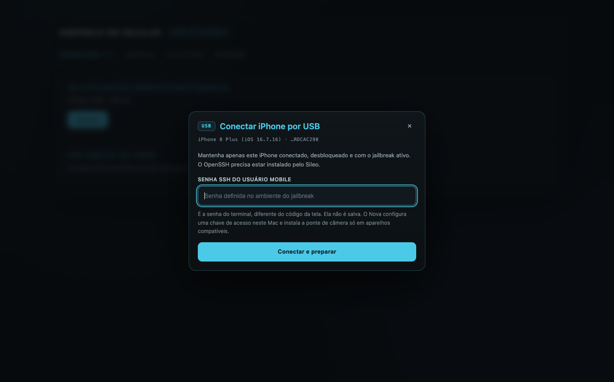
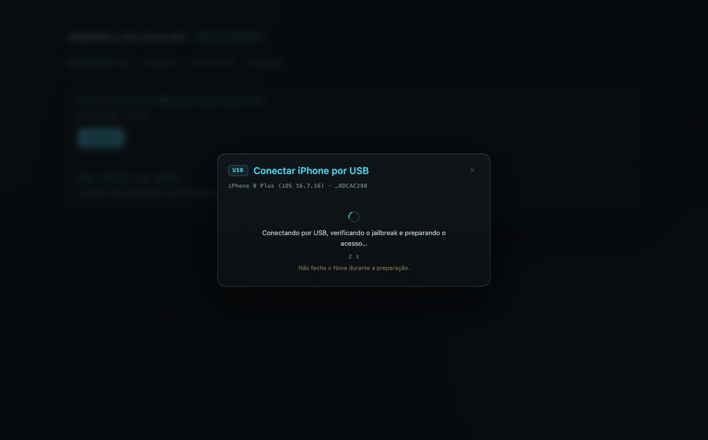
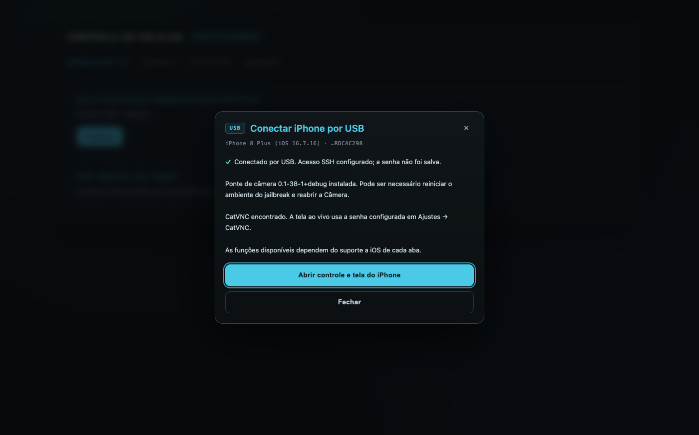
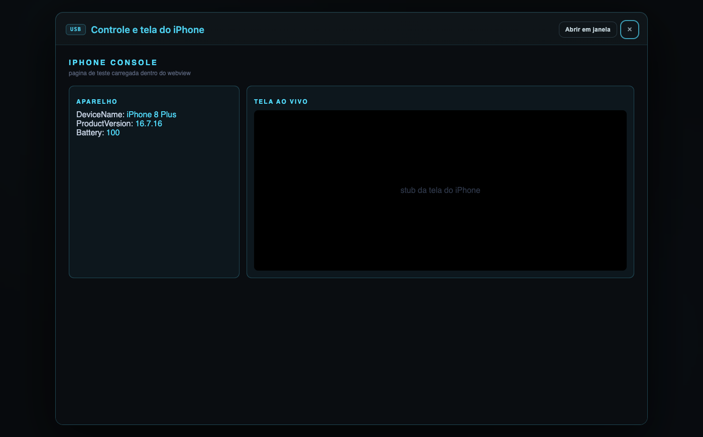
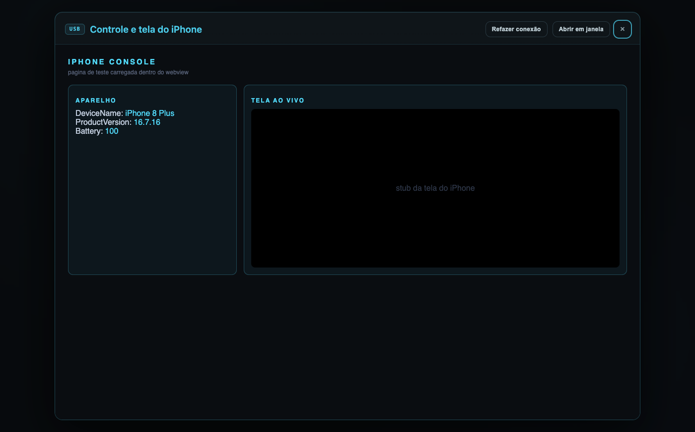

# Conexão do iPhone por USB — modal dentro do app

> Estado em 04/11/2026. Antes, clicar em **Conectar** num iPhone abria uma janela
> 540×660 carregando `conectar.html` — parecia um site/servidor à parte, fora do Nova.
> Agora a senha SSH, o progresso e o próprio controle do iPhone são desenhados
> **dentro da janela principal**, como um modal do aplicativo.



## O que muda

- **Sem janela externa.** `physical-mobile:start-stream` para IDs `ios-` pede ao
  `main.js` que mande o evento `nova:iphone-setup-open` para a janela principal.
  O `preload.js` recebe e desenha o modal (`inapp.js`) sobre o app, com fundo
  escurecido/embaçado, no mesmo visual do Controle do Celular.
- **Senha só no campo.** O input é limpo antes do IPC, a senha vai apenas para
  `physical-mobile:iphone-prepare` e não é salva. Erros nunca ecoam a senha.
- **Preparação com progresso.** Enquanto o SSH/keygen/ponte de câmera roda, o modal
  mostra spinner e tempo decorrido; fechar (X, Esc, clique fora) fica bloqueado.
- **Controle embutido.** Depois do sucesso, "Abrir controle e tela do iPhone" carrega
  o iPhone Console (`127.0.0.1:8778`, noVNC) num `<webview>` dentro do modal, com
  "Abrir em janela" como alternativa se o webview falhar.

 



## Botão do cartão depois de conectado — 04/11/2026

Antes, conectar o iPhone não mudava o cartão: ele continuava em **Conectar**. Agora:

- `physicalMobileService.iosPrepared(udid)` lê o `physical_mobile/iphone-hosts.json`
  (impressão digital gravada por um Conectar bem-sucedido) e o `getStatus()` marca esse
  iPhone como `streaming: true` — o mesmo campo que o painel já usa para trocar o botão.
- No cartão, iPhone preparado mostra **Abrir controle** (ciano) e chama
  `physical-mobile:ios-console-open`. Android continua com "Parar transmissão".
- O `main.js` avisa o painel (`physical-mobile:status-updated`) quando a preparação
  termina, então o botão muda na hora; a consulta de 5 em 5 segundos mantém o estado.
- "Abrir controle" abre o console dentro do app **sem pedir senha de novo**. O botão
  **Refazer conexão**, no topo do controle, reabre o quadro de senha quando precisar.



O bundle do renderer já compilado foi ajustado só nesses dois pontos por
`aplicar-botao-iphone.py` (idempotente; valida a sintaxe com `node --check` em cópia `.mjs`).
Cópia aplicada em `dist/index-Dun7lr2S.patched.js`.

## Arquivos

| Arquivo | Papel |
|---|---|
| `app/electron/services/iphone-setup/inapp.js` | modal + console embutido; roda no preload (mundo isolado), fora do bundle React |
| `app/electron/services/iphone-setup/setup.js` | valida a senha, instala a chave SSH e a ponte de câmera; `prompt()` manda o modal abrir |
| `setup.test.cjs` | testes de limite do serviço (senha, aparelho único, janela ausente) |
| `aplicar-botao-iphone.py` | patch do botão "Abrir controle" no bundle compilado |
| `botao.test.cjs` | valida o trecho do botão no bundle patcheado |
| `botao-servico.test.cjs` | valida `iosPrepared()` e o `streaming` no `getStatus()` |
| `dist/index-Dun7lr2S.patched.js` | bundle já patcheado (com os patches anteriores) |
| `test/modal/` | harness Electron que renderiza o modal e testa o IPC real do preload |
| `docs/*.png` | capturas do harness |

## Alterações feitas no app instalado

`electron/main.js` (em `registerHandlers()`):

```js
// iPhone: nenhuma janela externa. O modal de senha é desenhado dentro do Nova.
ipcMain.handle('physical-mobile:start-stream', async (event, id) => {
  if (String(id).startsWith('ios-')) {
    const payload = { id: String(id) };
    try {
      const status = await app.physicalMobileService.getStatus();
      const device = (status.devices || []).find((item) => item.id === id);
      if (device && device.name) payload.name = device.name;
    } catch (e) { /* segue sem o nome do aparelho */ }
    return require('./services/iphone-setup/setup').prompt(mainWindow, payload);
  }
  return app.physicalMobileService.startStream(id);
});
ipcMain.handle('physical-mobile:iphone-prepare', async (event, data) => {
  if (!mainWindow || event.sender !== mainWindow.webContents) return { success: false, error: 'Janela do Nova indisponível.' };
  const { id, password } = data || {};
  if (!id) return { success: false, error: 'Selecione um iPhone conectado.' };
  try { return await require('./services/iphone-setup/setup').prepare(String(id), password, app.physicalMobileService); }
  catch (e) { return { success: false, error: e.message }; }
});
ipcMain.handle('physical-mobile:ios-console-url', async () => { /* inicia ios-bridge e devolve a URL local */ });
ipcMain.handle('physical-mobile:ios-console', async (event, id) => app.physicalMobileService.iosStartStream(id));
```

Também foram adicionados o helper `novaIosConsolePortOpen(port)` acima de
`registerHandlers()` e, no `iphone-prepare`, o aviso `physical-mobile:status-updated`
com `{ deviceId, streaming: true }` depois do sucesso.

`electron/services/physicalMobileService.js`:

```js
iosPrepared(udid) {
    try {
        const pinsFile = path.join(this.baseDir, 'iphone-hosts.json');
        if (!fs.existsSync(pinsFile)) return false;
        const pins = JSON.parse(fs.readFileSync(pinsFile, 'utf8'));
        return !!(pins && pins[udid]);
    } catch (e) { return false; }
}
// getStatus(): streaming: this.runningStreams.has(d.id) ||
//              (isIos && this.iosPrepared(String(d.id).slice(4)))
```

`dist/assets/index-Dun7lr2S.js` (renderer): `aplicar-botao-iphone.py` cria
`PI(id)` (canal `physical-mobile:ios-console-open`) e troca o botão do cartão. Se o
app for atualizado e o bundle mudar de nome/conteúdo, o script avisa em vez de
gravar errado.

`electron/preload.js` (no fim do arquivo):

```js
try {
    const { attach: attachIphoneSetup } = require('./services/iphone-setup/inapp');
    attachIphoneSetup({ ipcRenderer });
} catch (error) {
    console.error('[Nova] Não foi possível preparar o modal do iPhone:', error);
}
```

O app instalado em `/Applications/Nova AI Mac.app` já está com essas alterações;
`conectar.html`, `conectar.js` e o `preload.js` da janela antiga foram removidos
(cópias em `../reservas/modal-externo-20261104/`).

## Testes executados

- `node --check` em `main.js`, `preload.js`, `inapp.js` e `setup.js`.
- `node setup.test.cjs` — modal pedido à janela certa, recusa de senha vazia/com quebra
  de linha/grande, bloqueio de múltiplos aparelhos, senha ausente das mensagens.
- `node botao.test.cjs` — executou o trecho do cartão no bundle patcheado: iPhone
  preparado chama `ios-console-open` e mostra "Abrir controle"; Android continua
  chamando `stop-stream` e mostrando "Parar transmissão".
- `node botao-servico.test.cjs` — sem pin o iPhone não é "streaming"; com pin vira
  "Abrir controle" e o Android não muda; JSON quebrado não derruba o painel.
- Harness `test/modal/` em Electron com o **preload real** do app:
  - `integracao.js` abriu o modal via IPC, enviou a senha por
    `physical-mobile:iphone-prepare`, recebeu a resposta e confirmou que o campo ficou
    vazio (`senhaNoDom: ""`);
  - estados `idle`, `running`, `success`, `error` e o `<webview>` do console
    renderizaram sem exceção no console do renderer;
  - o modal abriu primeiro só com o ID e recebeu o nome do aparelho depois
    (mesmo caminho do `main.js`), sem atrasar a abertura.

Para repetir (fecha a janela sozinho):

```sh
cd test/modal
env -u ELECTRON_RUN_AS_NODE TEST_STATE=idle  "/Applications/Nova AI Mac.app/Contents/Resources/app/node_modules/.bin/electron" main.js
env -u ELECTRON_RUN_AS_NODE "/Applications/Nova AI Mac.app/Contents/Resources/app/node_modules/.bin/electron" integracao.js
```

`ELECTRON_RUN_AS_NODE` precisa estar vazio nesta máquina, senão o binário roda como
Node e não encontra o módulo `electron`. As capturas vão para `test/modal/shots/`.

## Limites

- **Conexão real no aparelho não foi executada aqui** (exige a senha SSH do iPhone do
  usuário). O fluxo SSH em si é o mesmo de antes; o que mudou é a interface.
- O console embutido depende do `<webview>` do Electron. Se carregar errado, o botão
  "Abrir em janela" mantém o caminho anterior.
- O DMG não foi regenerado: a mudança está só no app instalado. **Feche e reabra o Nova.**

## Como desfazer

1. Copie `../reservas/modal-externo-20261104/setup.js`, `conectar.html`, `conectar.js` e
   `preload.js` de volta para `Contents/Resources/app/electron/services/iphone-setup/` e
   apague `inapp.js`.
2. Em `electron/main.js`, volte `physical-mobile:start-stream` para
   `require('./services/iphone-setup/setup').open(id, app.physicalMobileService)` e remova
   os três handlers novos.
3. Em `electron/preload.js`, remova o bloco `attachIphoneSetup`.
4. Reabra o Nova.

## Relacionado

- `../README.md` — integração iPhone (ponte de câmera, CAM HIJACK).
- `../../LEIA-ME.md` — histórico do projeto Mac.
